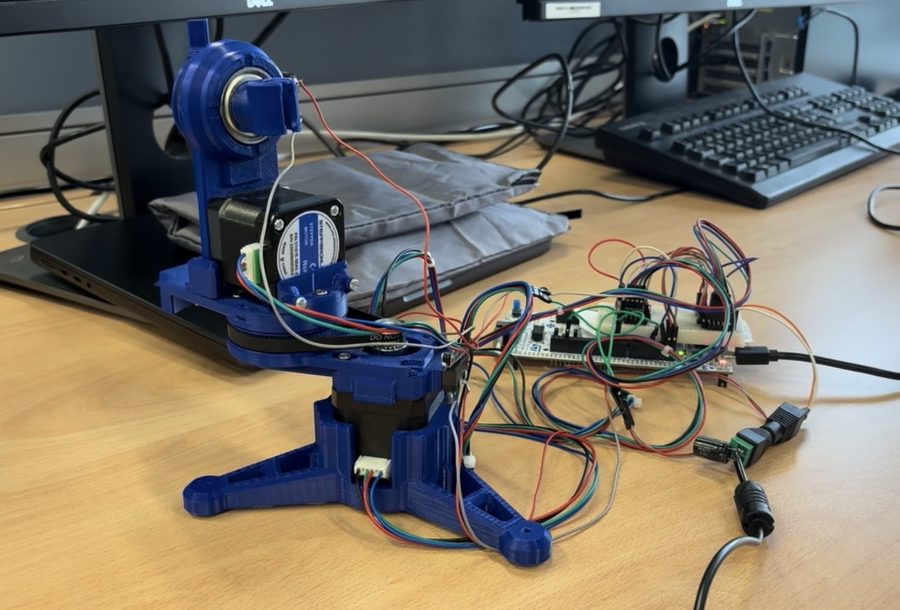
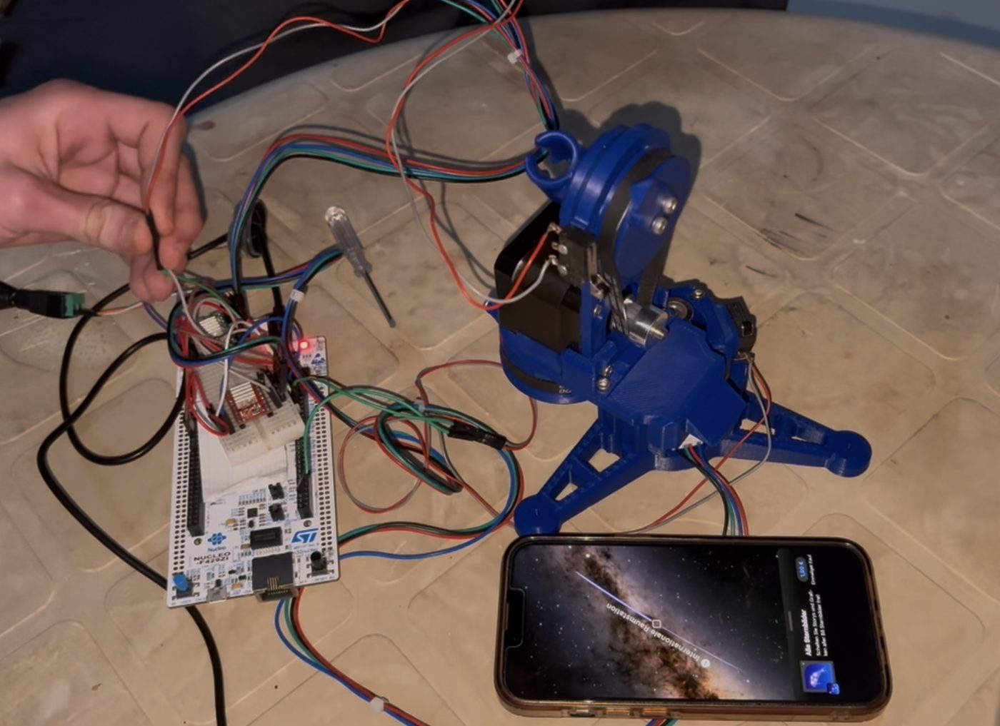
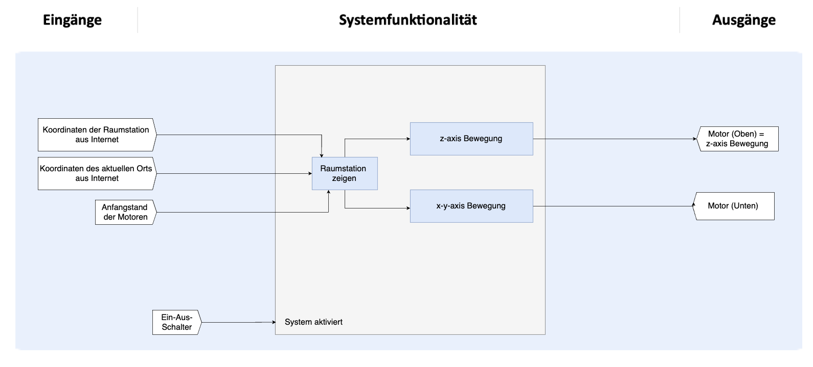
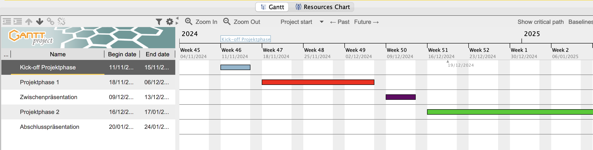

# ISS Tracker: Two-Axis Satellite Tracker on STM32

A 3D-printed pan-tilt mount that points at the International Space Station (ISS) in real time. A Python script fetches the ISS position from a public API and streams it over USB serial to an STM32 Nucleo board. The board converts the position into azimuth and elevation angles for the observer's location and drives two stepper motors to match.

Group project (Group 3), RWTH Aachen University, November 2024 – January 2025.
<!-- TODO(Lio): add the course name, e.g. "for the course <name>". -->



## How it works

```
api.wheretheiss.at ─────[HTTP, ~1 Hz]───── 
                                          │                                                                             
                                          ─────▶ iss_position_streamer.py ─────[USB serial, "lat,lon,alt\r\n"]─────▶ NUCLEO-F429ZI
                                                                                                                           │
                                                                                          coord2angles.c: ISS + observer position ───▶ azimuth, elevation
                                                                                          stepper.c:      STEP/DIR pulses to two stepper drivers
                                                                                                                           │
                                                                                                                           ▼
                                                                                                 lower motor = azimuth, upper motor = elevation
```

At start-up, each axis drives to a limit switch to find its home position and counts the steps in one revolution. After that, the main loop parses each new position message, recomputes the pointing angles and moves both motors by the change in angle.

### From latitude/longitude to pointing angles

`firmware/Core/Src/coord2angles.c` does the conversion in four steps:

1. **Geodetic → ECEF.** Converts latitude, longitude and altitude of both the ISS and the observer into Earth-Centred, Earth-Fixed Cartesian coordinates on the WGS-84 ellipsoid.
2. **ECEF → ENU.** Rotates the difference vector (ISS minus observer) into the observer's local East-North-Up frame.
3. **ENU → angles.** azimuth = atan2(E, N) and elevation = atan2(U, √(E² + N²)).
4. **Refraction.** Corrects the elevation for atmospheric refraction with Bennett's approximation.

## My role

<!-- TODO(Lio): check the wording. -->
- Wrote the angle-conversion module (`coord2angles.c` / `coord2angles.h`) in C, covering all four steps above.
- Tested the integrated system at the end of the project and checked the pointing direction against a stargazing app.

## Repository layout

```
firmware/                    STM32CubeIDE project (C, STM32 HAL), target NUCLEO-F429ZI
  Core/Src/main.c            UART reception, message parsing, main control loop
  Core/Src/coord2angles.c    coordinate conversion (see above)
  Core/Src/stepper.c         STEP/DIR stepper control and limit-switch calibration
  Raumstation-Tracker.ioc    CubeMX pin and clock configuration
python-api/
  iss_position_streamer.py   polls the ISS position and sends it to the board
  requirements.txt
docs/
  system_diagram_grp3.drawio system diagram (draw.io)
  gantt_chart_grp3.gan       project plan (GanttProject)
  media/                     photos and exported diagrams
```

## Running it

1. **Firmware.** In STM32CubeIDE, choose *File ▸ Import ▸ Existing Projects into Workspace*, select `firmware/`, then build and flash it to a NUCLEO-F429ZI. The observer location is set in `main.c` (`robotLat`, `robotLon`; the default is Aachen).
2. **Host script.**
   ```bash
   pip install -r python-api/requirements.txt
   python python-api/iss_position_streamer.py
   ```
   The serial port is hard-coded in the `serial.Serial(...)` call. Change it to your board's port first.

## Gallery

| | |
|---|---|
|  |  |
| Test run: pointing compared with a stargazing app | System diagram: inputs, functions and outputs (in German) |


*Project plan: kick-off, two project phases, mid-term and final presentation*

## Limitations and possible improvements

- **Message framing.** The firmware receives exactly 35 bytes per UART transfer, but the message length depends on the number of digits and signs, so later messages can be read out of alignment. Reading up to the `\n` terminator, or using idle-line detection, would fix this.
- **Sub-degree motion.** The angle change is passed to `stepper_rotate()` as an `int`. Any change smaller than 1° per update is therefore truncated to zero and lost. Tracking an absolute step target would avoid this accumulated error.
- **Azimuth wrap-around.** The azimuth jumps between −180° and +180° when the ISS passes due south. At that point the base turns almost a full revolution instead of a few degrees. Wrapping the difference into (−180°, 180°] would fix this.
- **Fixed observer position.** The observer location is hard-coded rather than configured at run time.
